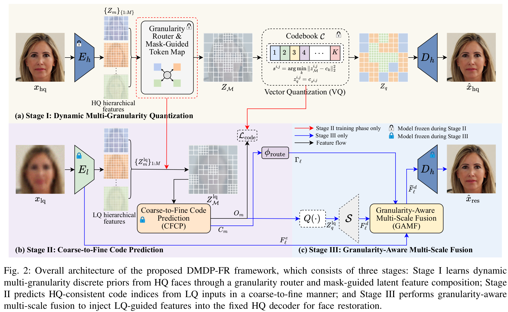
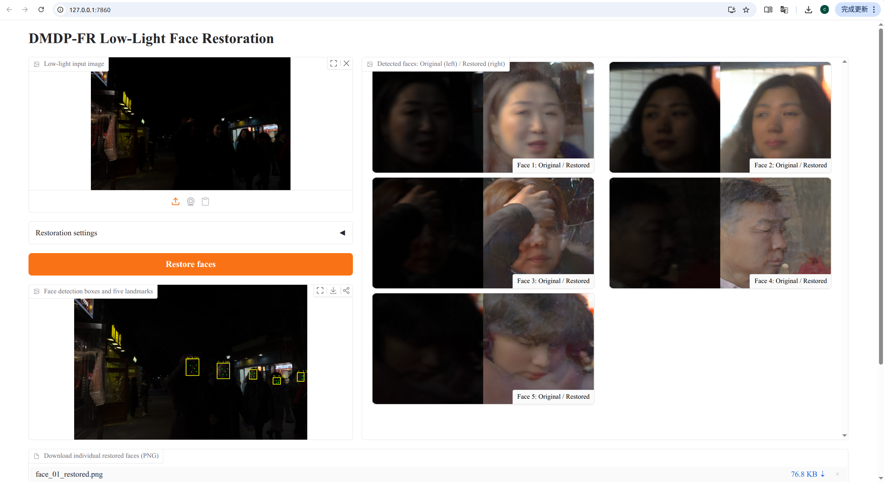
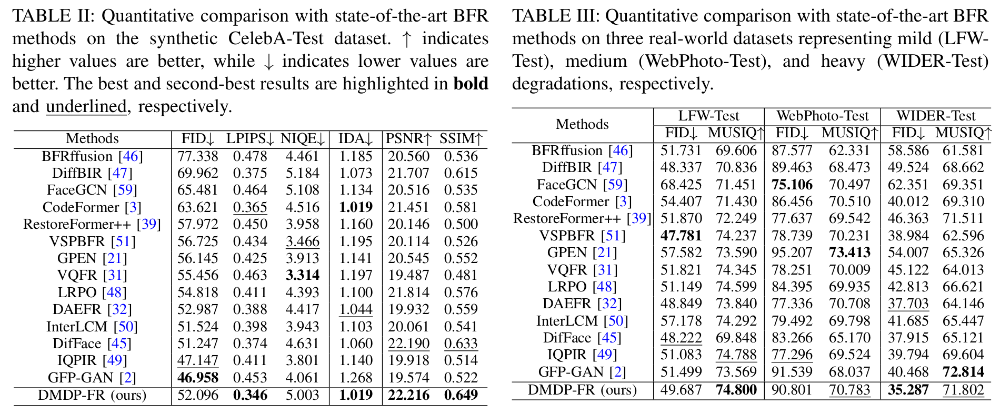
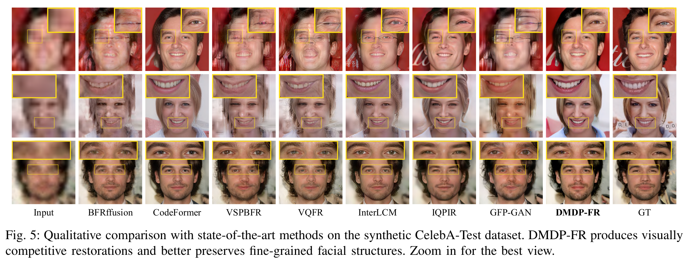
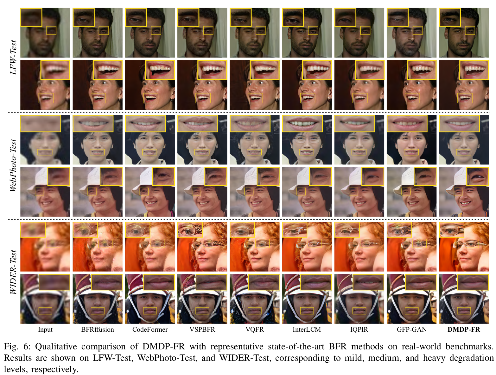
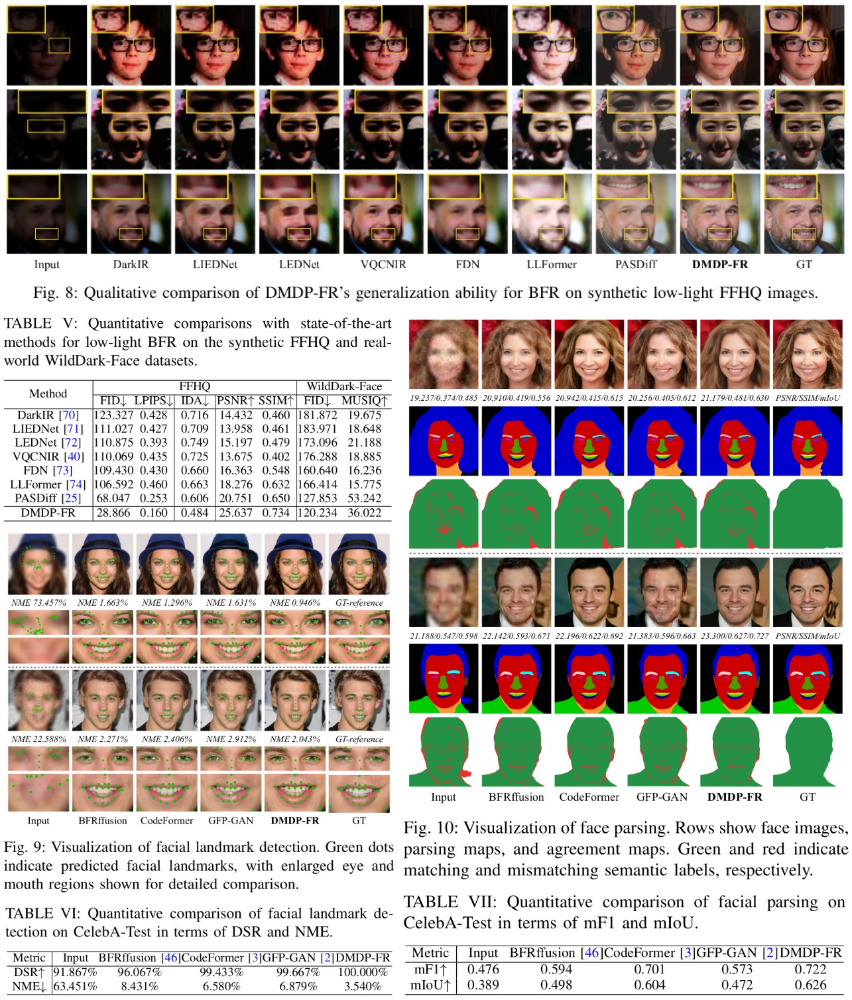

# Dynamic Multi-Granularity Discrete Prior Representation for Blind Face Restoration (DMDP-FR)

This is the PyTorch implementation of **DMDP-FR**, including dynamic multi-granularity quantization prior learning, coarse-to-fine code prediction, granularity-aware fusion, training configurations, and inference/evaluation utilities.



DMDP-FR restores degraded faces in three stages:

| Stage | Module | Purpose |
| --- | --- | --- |
| I | Dynamic Multi-Granularity Quantization (DMGQ) | Learns a discrete HQ face prior with adaptive coarse/medium/fine token allocation. |
| II | Coarse-to-Fine Code Prediction (CFCP) | Predicts HQ-aligned discrete codes from LQ inputs, recovering global structure before local details. |
| III | Granularity-Aware Multi-Scale Fusion (GAMF) | Injects LQ-guided features into the fixed HQ decoder using predicted granularity distributions. |

## :runner: TODO

- ✅ Provide training code and configurations for all three stages.
- ✅ Support aligned-face inference, granularity visualization, and image-quality evaluation.
- ✅ Provide pretrained checkpoint download links.
- ✅ Provide 256 x 256 paired low-light training configurations and a whole-image Gradio demo.
- [ ] Add DMDP-FR publication information and BibTeX citation.

## :wrench: Dependencies and Installation

### Step 1: Create the Conda environment

The provided [environment.yml](environment.yml) defines the `dmdpfr` environment with Python `3.11.10`, PyTorch `2.5.1+cu124`, TorchVision `0.20.1+cu124`, and TorchAudio `2.5.1+cu124`. It includes CUDA `12.4` runtime packages and the training/evaluation dependencies. Ubuntu `22.04` and an NVIDIA GPU with a CUDA 12.4-compatible driver are recommended.

Clone or download the project into a folder named `DMDP-FR`, then create and activate the environment from the repository root:

```bash
cd /path/to/DMDP-FR
PIP_EXTRA_INDEX_URL=https://download.pytorch.org/whl/cu124 \
  conda env create -f environment.yml
conda activate dmdpfr
```

The extra pip index provides the CUDA 12.4 PyTorch wheels pinned in the YAML file; see the [official PyTorch installation instructions](https://pytorch.org/get-started/previous-versions/#v251).

### Step 2: Install the local BasicSR package

With `dmdpfr` activated, install the project's BasicSR implementation from the repository root. Use `--no-deps` to preserve the dependency versions restored from `environment.yml`:

```bash
python basicsr/setup.py develop --no-deps
```

The environment already includes FaceXlib `0.3.0`, LPIPS `0.1.4`, and pyiqa `0.1.16`. Gradio is installed separately for the whole-image demo:

```bash
python -m pip install -r requirements-gradio.txt
```

## :rocket: Quick Inference

### Step 1: Prepare pretrained checkpoints

Download the pretrained weights from Baidu Netdisk:

- **BFR:** Weights for the original 512 x 512 blind face restoration model — [Download](https://pan.baidu.com/s/1sZ1qcciduVsgC8UiQhDqBg) (extraction code: `kvur`).
- **Dark BFR:** Weights for the 256 x 256 low-light blind face restoration model — [Download](https://pan.baidu.com/s/1pIs5WQp4EtkS9hT5GlDWIQ?pwd=6xrh) (extraction code: `6xrh`).

Place the pretrained weights in the following directory structure, taking Dark BFR as an example:

```text
experiments/
├── DMDP-FR_darkface_stage1_triple/
│   └── models/
│       ├── net_g_latest.pth
│       └── net_d_latest.pth
├── DMDP-FR_darkface_stage2_triple/
│   └── models/
│       └── net_g_latest.pth
└── DMDP-FR_darkface_stage3_triple/
    └── models/
        ├── net_g_latest.pth
        └── net_d_latest.pth
weights/
└── facelib/
    ├── detection_Resnet50_Final.pth
    └── parsing_parsenet.pth
```

### Step 2: Run the Gradio demo

Start the demo from the repository root after preparing the matching low-light checkpoint:

```bash
python gradio_app.py
```

Open `http://127.0.0.1:7860` in your browser:

1. Upload a whole image in **Low-light input image**.
2. Adjust the detection settings and **DMDP-FR fusion weight** if needed, then click **Restore faces**.
3. Inspect the restored image, detected landmarks, and original/restored face pairs.
4. Download the restored faces as PNG files or the full results as a ZIP archive.



The demo defaults to
`options/DMDP-FR_darkface_stage3_triple.yml` and
`experiments/DMDP-FR_darkface_stage3_triple/models/net_g_latest.pth`.
Use `--opt` and `--ckpt` to select another matching DMDP-FR configuration and checkpoint.

[FaceXlib](https://github.com/xinntao/facexlib) downloads these official weights on first use,
or reads them from `weights/facelib/` (override with `--model-dir`):

- [detection_Resnet50_Final.pth](https://github.com/xinntao/facexlib/releases/download/v0.1.0/detection_Resnet50_Final.pth)
- [parsing_parsenet.pth](https://github.com/xinntao/facexlib/releases/download/v0.2.2/parsing_parsenet.pth)

Results are saved under `results/gradio/`. Use `--output-dir` to select another output directory.

For a remote GPU machine, keep the default local binding and forward the port:
`ssh -L 7860:127.0.0.1:7860 user@server`. Set `--host 0.0.0.0` only when LAN access is intended.

### Step 3: Run aligned-face inference

For the original 512 x 512 model, place aligned LQ face crops in an input directory and run:

```bash
python scripts/visualize_eval_dmdp_fr.py \
  -i datasets/faces/validation/lq \
  -o results/dmdp_fr/celebA_test \
  --opt options/DMDP-FR_stage3_triple.yml \
  --ckpt_path experiments/pretrained_models/dmdp_fr/dmdp_fr_stage3.pth \
  --save_comparison \
  --save_gate_map
```

The script saves restored faces in `restored/`, side-by-side images in `comparison/`, and granularity visualizations under the selected output directory. Use `--device cpu` for CPU inference. Add `--gt_path` and `--metrics` to evaluate the restored images as described in [Results](#computer-results).

### Step 4: Downstream facial analysis

The restored faces saved in `restored/` can be used as inputs to pretrained models for downstream facial analysis.

- Facial landmark detection: apply a fixed pretrained [FAN](https://github.com/1adrianb/face-alignment) to localize facial landmarks. DMDP-FR restores facial structure and improves landmark alignment with the HQ references, particularly around the eyes and mouth.
- Face parsing: apply a fixed pretrained [ParseNet](https://github.com/xinntao/facexlib/blob/master/facexlib/parsing/parsenet.py) to predict facial semantic maps. DMDP-FR improves agreement with the HQ reference maps and reduces semantic label mismatches at facial component boundaries.

In the CelebA-Test evaluation, the same pretrained models are applied to degraded inputs, restored faces, and corresponding HQ images. Predictions from the HQ images serve as references. Qualitative comparisons are included in [Results](#computer-results).

## 🚂 Training

### Step 1: Prepare training and validation datasets

Keep all datasets under `./datasets/` and edit the `dataroot_*` fields in `options/*.yml` if your local paths are different.

#### Training dataset

DMDP-FR uses [FFHQ](https://github.com/NVlabs/ffhq-dataset) for all three training stages. The images should be aligned face images at `512x512`.

The original FFHQ images are `1024x1024`. Resize them to `512x512` before training. A simple layout is:

```text
datasets/
  ffhq/
    ffhq_512/
      00000.png
      00001.png
      ...
```

For standard BFR training, Stage I learns the HQ prior without synthetic corruption. LQ/HQ training pairs are generated on the fly using the degradation pipeline in [ffhq_blind_dataset.py](basicsr/data/ffhq_blind_dataset.py), following the degradation formulation used in [CodeFormer](https://github.com/sczhou/CodeFormer) and [DAEFR](https://github.com/LIAGM/DAEFR). The pipeline combines random Gaussian blur, resampling, additive Gaussian noise, and JPEG compression, followed by resizing to the network input size.

Stage III uses [ffhq_blind_joint_dataset.py](basicsr/data/ffhq_blind_joint_dataset.py) to generate both mild and severe degradations. Sampling ranges are specified in the corresponding `options/*.yml` files. Dark BFR uses pre-generated paired low-light images as described in [low-light training](docs/darkface_training.md).

#### Validation and test datasets

Please put the following validation and testing datasets under the `./datasets/` folder.

| Datasets | Data Type | Short Description | Download                                                                                                 |
| --- | --- | --- |----------------------------------------------------------------------------------------------------------|
| CelebA-Test | `gt + lq` | 3000 paired HQ/LQ images for full-reference evaluation | [CelebA-Test](https://mmlab.ie.cuhk.edu.hk/projects/CelebA.html)                                         |
| LFW-Test | `lq only` | 1711 real-world LQ images for testing | [LFW-Test](https://huggingface.co/datasets/LIAGM/DAEFR_test_datasets/resolve/main/lfw_cropped_faces.zip) |
| WebPhoto-Test | `lq only` | 407 real-world LQ images for testing | [WebPhoto-Test](https://github.com/TencentARC/GFPGAN)                                                    |
| WIDER-Test | `lq only` | 970 real-world LQ images for testing | [Wider-Test](https://huggingface.co/datasets/LIAGM/DAEFR_test_datasets/resolve/main/Wider-Test.zip)      |

For the default validation during training, prepare the paired CelebA-Test images under `datasets/faces/validation/`. The `gt` folder contains aligned HQ faces. The `lq` folder contains the corresponding degraded LQ faces for Stage-II and Stage-III validation.

```text
datasets/
  faces/
    validation/
      gt/
        000001.png
        000002.png
        ...
      lq/
        000001.png
        000002.png
        ...
```

For real-world testing, only LQ images are available. A recommended layout is:

```text
datasets/
  faces/
    real_world/
      lfw_test/
        lq/
          000001.png
          000002.png
          ...
      webphoto_test/
        lq/
          000001.png
          000002.png
          ...
      wider_test/
        lq/
          000001.png
          000002.png
          ...
```

#### Optional latent GT cache

For the original 512 x 512 configurations, Stage-II and Stage-III can either generate DMGQ latent supervision online from `network_vqgan`, or read precomputed latent codes by setting `datasets.train.latent_gt_path` in the YAML config.

Generate the cache with:

```bash
python scripts/generate_dmgq_latent_gt.py \
  -i datasets/ffhq/ffhq_512 \
  --opt options/DMDP-FR_stage1_triple.yml \
  --ckpt_path experiments/pretrained_models/dmgqvae/dmgqvae_stage1_triple.pth \
  -o experiments/pretrained_models/dmgqvae
```

Then set, for example:

```yaml
datasets:
  train:
    latent_gt_path: experiments/pretrained_models/dmgqvae/latent_gt_dmgq_triple_code1024.pth
```

### Step 2: Configure the three training stages

The following configurations describe the original 512 x 512 blind face restoration setting:

| Stage | Configuration | Initialization |
| --- | --- | --- |
| I. Triple-granularity prior | [DMDP-FR_stage1_triple.yml](options/DMDP-FR_stage1_triple.yml) | Train the HQ prior from FFHQ images. |
| I. Optional dual-granularity prior | [DMDP-FR_stage1_dual.yml](options/DMDP-FR_stage1_dual.yml) | Alternative prior with two granularities. |
| II. Coarse-to-fine code prediction | [DMDP-FR_stage2_triple.yml](options/DMDP-FR_stage2_triple.yml) | Load the matching Stage-I prior for initialization and supervision. |
| III. Granularity-aware fusion | [DMDP-FR_stage3_triple.yml](options/DMDP-FR_stage3_triple.yml) | Initialize the generator from Stage II and retain supervision from the Stage-I prior. |

Prepare `weights/lpips/vgg.pth` for the Stage-I perceptual loss. This file is the LPIPS VGG linear-weight checkpoint; the VGG16 feature weights must also be available in the Torch Hub cache. See [low-light training](docs/darkface_training.md#dependencies-and-perceptual-loss-weights) for preparation instructions shared by both settings.

### Step 3: Run training commands

The supplied configurations use one GPU. Run the stages sequentially, updating checkpoint paths after each stage:

```bash
# Stage I: Learn the triple-granularity HQ prior.
python -m basicsr.train -opt options/DMDP-FR_stage1_triple.yml

# Stage II: Train coarse-to-fine code prediction.
python -m basicsr.train -opt options/DMDP-FR_stage2_triple.yml

# Stage III: Train granularity-aware fusion.
python -m basicsr.train -opt options/DMDP-FR_stage3_triple.yml
```

For the optional dual-granularity prior:

```bash
python -m basicsr.train -opt options/DMDP-FR_stage1_dual.yml
```

For distributed training, set `num_gpu: 4` in the selected configuration and launch four GPU processes. For example:

```bash
torchrun --nproc_per_node=4 --master_port=29434 --module basicsr.train \
  -opt options/DMDP-FR_stage1_triple.yml --launcher pytorch
```

Use the corresponding Stage-II/III YAML files for subsequent stages. Adjust `batch_size_per_gpu` and `train.grad_accum_steps` for the available GPU memory.

Optional task-specific configurations:

```bash
python -m basicsr.train -opt options/DMDP-FR_colorization.yml
python -m basicsr.train -opt options/DMDP-FR_inpainting.yml
```

### Step 4: Train the 256 x 256 low-light model (optional)

For the local paired low-light FFHQ dataset, use the separate configurations:

```bash
python -m basicsr.train -opt options/DMDP-FR_darkface_stage1_triple.yml
python -m basicsr.train -opt options/DMDP-FR_darkface_stage2_triple.yml
python -m basicsr.train -opt options/DMDP-FR_darkface_stage3_triple.yml
```

See [low-light training](docs/darkface_training.md) for data layout, checkpoint dependencies, and resume settings. The folder name `darkface` refers to locally synthesized paired FFHQ data. These configurations use a different architecture from the original 512 x 512 model; their checkpoints and latent caches must match that architecture.

## :computer: Results









DMDP-FR demonstrates generalization to low-light face restoration on synthetic FFHQ and real-world WildDark-Face. By recovering facial structure, it also supports downstream facial landmark detection and face parsing, with improved results over the degraded inputs and compared restoration methods.

### 📊 Reproduce the evaluation

#### Step 1: Evaluate on paired CelebA-Test

Use this setting for paired benchmarks such as CelebA-Test. The command saves restored images, LQ/restored/GT comparisons, granularity maps, and full-reference metrics.

```bash
python scripts/visualize_eval_dmdp_fr.py \
  -i datasets/faces/validation/lq \
  -o results/dmdp_fr/celebA_test \
  --gt_path datasets/faces/validation/gt \
  --opt options/DMDP-FR_stage3_triple.yml \
  --ckpt_path experiments/pretrained_models/dmdp_fr/dmdp_fr_stage3.pth \
  --fid_ref_path datasets/ffhq/ffhq_512 \
  --save_comparison \
  --save_gate_map \
  --metrics fid,lpips,niqe,psnr,ssim
```

#### Step 2: Evaluate on real-world benchmarks

Use this setting for real-world LQ-only benchmarks such as LFW-Test, WebPhoto-Test, and WIDER-Test. Omit `--gt_path`. The example below uses a separately prepared real-world checkpoint; update `--ckpt_path` to your downloaded or trained weights and use its matching configuration.

```bash
python scripts/visualize_eval_dmdp_fr.py \
  -i datasets/faces/real_world/lfw_test/lq \
  -o results/dmdp_fr/lfw_test \
  --opt options/DMDP-FR_stage3_triple_iqa_unfreeze.yml \
  --ckpt_path experiments/pretrained_models/dmdp_fr/real-world_net_g_latest.pth \
  --fid_ref_path datasets/ffhq/ffhq_512 \
  --save_comparison \
  --save_gate_map \
  --metrics fid,musiq \
  --w 0.1
```

Replace `datasets/faces/real_world/lfw_test/lq` with `datasets/faces/real_world/webphoto_test/lq` or `datasets/faces/real_world/wider_test/lq` for the other real-world test sets.

## :book: Citation

## :handshake: Acknowledgements

This project is based on [BasicSR](https://github.com/XPixelGroup/BasicSR), [CodeFormer](https://github.com/sczhou/CodeFormer), [VQFR](https://github.com/TencentARC/VQFR), and [DAEFR](https://github.com/LIAGM/DAEFR).

## :postbox: Contact

If you have any questions, feel free to approach me at jinchuan@tongji.edu.cn
